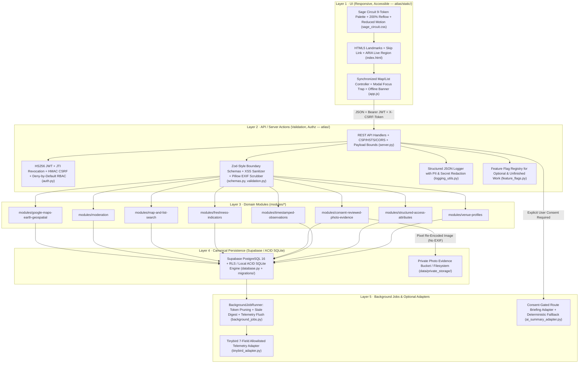
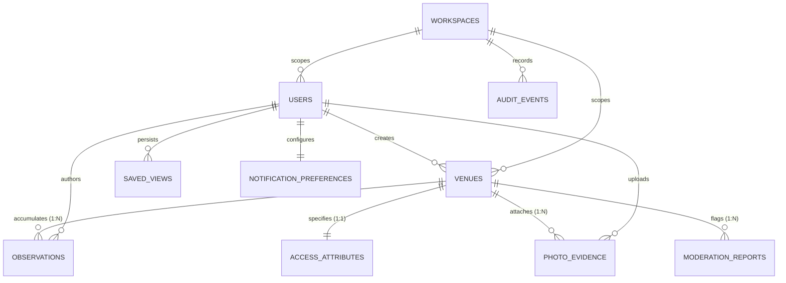

# System Design & Architecture Decision Records — AccessAble Atlas

**Repository:** `accessable-atlas`  
**Version:** `1.0.0`  
**Design System:** Sage Circuit (`#030407`, `#A5A79B`, `#E8D2B5`, `#590907`, `#1558C9`, `#D4FF24`, `#E7B0DE`, `#400849`, `#FF5A0A`)  
**Canonical Transactional Store:** Supabase (`PostgreSQL 16` + Row-Level Security) with zero-config local ACID SQLite parity ([`atlas/db/database.py`](file:///home/nightwalker-dev/codex/atlas/db/database.py))

---

## 1. Layered Architecture & Request Lifecycle

AccessAble Atlas enforces a strict 5-layer architecture from accessible client UI down to background maintenance jobs:

`UI (responsive, accessible)` → `API/server actions (validation, authz)` → `domain modules` → `Supabase` → `background jobs`

---

## 2. Domain Modules (`modules/*`) & Cross-Cutting Matrix

### 2.1 Domain Modules

| Domain Slice | Module Path | Boundary Schema (`atlas/schemas.py`) | Core Responsibility |
| :--- | :--- | :--- | :--- |
| **Venue profiles** | [`modules/venue-profiles`](file:///home/nightwalker-dev/codex/modules/venue-profiles/module.py) | `VenueProfileSchema`, `VenueImportSchema` | Venue CRUD, geospatial coordinates, barrier alerts, confirmed JSON import, soft-archive, and hard-delete. |
| **Structured access attributes** | [`modules/structured-access-attributes`](file:///home/nightwalker-dev/codex/modules/structured-access-attributes/module.py) | `StructuredAccessAttributesSchema` | Strongly-typed 1:1 physical entrance (`cm`/`mm`), restroom/lift, and interior route attributes + [`evaluate_accessibility_fit`](file:///home/nightwalker-dev/codex/atlas/domain.py#L258-L343). |
| **Timestamped observations** | [`modules/timestamped-observations`](file:///home/nightwalker-dev/codex/modules/timestamped-observations/module.py) | `TimestampedObservationSchema` | Append-only field observations with observer role, confidence tier (`95%`..`35%`), doorway measurements, and elevator checks. |
| **Consent-reviewed photo evidence** | [`modules/consent-reviewed-photo-evidence`](file:///home/nightwalker-dev/codex/modules/consent-reviewed-photo-evidence/module.py) | `PhotoEvidenceUploadSchema`, `PhotoReviewSchema` | Mandatory face/area consent attestations, required `alt_text`, Pillow pixel re-encoding (100% EXIF removal), and moderator approval queue. |
| **Freshness indicators** | [`modules/freshness-indicators`](file:///home/nightwalker-dev/codex/modules/freshness-indicators/module.py) | Deterministic pure output | 4-state freshness decay & barrier override engine (`fresh_verified`, `aging_review_soon`, `stale_reverify`, `active_alert`) with non-color icons (`[✓]`, `[◷]`, `[↻]`, `[!]`). |
| **Map and list search** | [`modules/map-and-list-search`](file:///home/nightwalker-dev/codex/modules/map-and-list-search/module.py) | `MapAndListSearchFilterSchema`, `SavedViewSchema` | Synchronized map/list filtering via single-query `LEFT JOIN` (`2` SQL `SELECT`s at any scale) + user-persisted `saved_views`. |
| **Moderation** | [`modules/moderation`](file:///home/nightwalker-dev/codex/modules/moderation/module.py) | `ModerationReportSchema`, `ModerationResolutionSchema` | Community inaccuracy/privacy flagging, moderator resolution workflow, and immutable workspace `audit_events`. |
| **Google Maps & Earth Geospatial** | [`modules/google-maps-earth-geospatial`](file:///home/nightwalker-dev/codex/modules/google-maps-earth-geospatial/module.py) | `GeospatialRouteQuerySchema` | Google Maps Wheelchair Transit, Street View 360° curb view, Google Earth 3D flyovers, ADA 1:12 ramp analysis, and OGC KML 2.2 export. |

### 2.2 Cross-Cutting Concerns

| Cross-Cutting Concern | Implementation | Verification Evidence |
| :--- | :--- | :--- |
| **Auth & roles on every route** | [`atlas/auth.py`](file:///home/nightwalker-dev/codex/atlas/auth.py) (`authorize_action`, `ROLE_PERMISSIONS`) enforced in [`atlas/server.py`](file:///home/nightwalker-dev/codex/atlas/server.py) and `modules/*/module.py` | Tested across `viewer`, `contributor`, `operator`, `moderator`, `admin`, and cross-workspace isolation in [`tests/test_security_and_abuse.py`](file:///home/nightwalker-dev/codex/tests/test_security_and_abuse.py) |
| **Zod-style schemas at all boundaries** | [`atlas/schemas.py`](file:///home/nightwalker-dev/codex/atlas/schemas.py) (`BoundarySchema.parse`, `BoundarySchema.safe_parse`, `BOUNDARY_SCHEMA_REGISTRY`) wrapping [`atlas/validation.py`](file:///home/nightwalker-dev/codex/atlas/validation.py) | 14 registered boundary schemas covering all JSON, query parameter, and multipart binary boundaries |
| **Structured logs with PII redaction** | [`atlas/logging_utils.py`](file:///home/nightwalker-dev/codex/atlas/logging_utils.py) (`StructuredLogger`, `redact_pii_and_secrets`, `mask_email`, `mask_ipv4`) | Masks emails (`m***@example.org`), IPs (`192.168.1.x`), JWTs (`[REDACTED_JWT]`), and secret keys (`[REDACTED]`) |
| **Feature flags for unfinished work** | [`atlas/feature_flags.py`](file:///home/nightwalker-dev/codex/atlas/feature_flags.py) (`FeatureFlagRegistry`) | Unfinished CV face-blurring (`automated_face_blur_prepass`) and GTFS-RT elevator sync (`realtime_transit_elevator_feed`) explicitly flagged off |
| **Reversible & reviewed migrations** | [`20261101000000_accessable_atlas_init.sql`](file:///home/nightwalker-dev/codex/supabase/migrations/20261101000000_accessable_atlas_init.sql) (UP) + [`20261101000001_accessable_atlas_rollback.down.sql`](file:///home/nightwalker-dev/codex/supabase/migrations/20261101000001_accessable_atlas_rollback.down.sql) (DOWN) | Transactional `BEGIN ... COMMIT` forward and reverse migrations with RLS policy and index cleanup |

---

## 3. Entity-Relationship Model

---

## 4. Architecture Decision Records (ADRs) & Trade-Offs

### ADR-001: Data Model (Venue Profiles, 1:1 Structured Access Attributes, & Append-Only Observations)

- **Status:** Accepted & Implemented ([`atlas/db/database.py`](file:///home/nightwalker-dev/codex/atlas/db/database.py), [`supabase/migrations/20261101000000_accessable_atlas_init.sql`](file:///home/nightwalker-dev/codex/supabase/migrations/20261101000000_accessable_atlas_init.sql), [`supabase/migrations/20261101000001_accessable_atlas_rollback.down.sql`](file:///home/nightwalker-dev/codex/supabase/migrations/20261101000001_accessable_atlas_rollback.down.sql))
- **Context:**
  A civic accessibility directory must represent diverse public places (`transit_hub`, `civic_building`, `healthcare`, `library_museum`, `park_trail`, `dining_retail`, `education`, `community_center`) with exact physical measurements (`entrance_door_width_cm`, `threshold_height_mm`, `turning_circle_cm`, `min_corridor_width_cm`), typed facility enums (`door_opener_type`, `accessible_restroom_type`, `elevator_status`, `pathway_surface`), and an auditable history of timestamped observations that decay over time.
- **Decision:**
  1. **Venue Profiles (`venues`):** Store core identity, geospatial coordinates, ownership (`created_by`, `workspace_id`), lifecycle state (`published`, `under_review`, `archived`), and `is_synthetic_sample` provenance flag. Enforce human confirmation (`user_confirmed_imported_values: true`) on imported JSON records (`POST /api/venues/import`).
  2. **Structured Access Attributes (`access_attributes`):** Model physical attributes as a strongly-typed `1:1` relational table (`venue_id PRIMARY KEY REFERENCES venues(id) ON DELETE CASCADE`) with SQL `CHECK` constraints on every numeric range and enum column, plus composite index `idx_access_attributes_filter (step_free_entrance, entrance_door_width_cm, accessible_restroom_type, elevator_status)`. Hydrate venue listings via a single `LEFT JOIN` inside [`AtlasDatabase.list_venues`](file:///home/nightwalker-dev/codex/atlas/db/database.py#L685-L874) (`2` SQL `SELECT` queries regardless of result set size).
  3. **Timestamped Observations & Freshness Decay (`observations`):** Maintain an append-only `observations` ledger per venue recording `observer_role`, `confidence_level` (`verified_measurement` = `95%`, `direct_observation` = `82%`, `secondhand_report` = `55%`, `needs_reverification` = `35%`), and `observed_at`. Compute freshness deterministically in [`compute_freshness_indicator`](file:///home/nightwalker-dev/codex/atlas/domain.py#L143-L256) across 4 states:
     - `active_alert` (`[!]`, Warning Triangle): Immediate priority when `active_barrier_alert` is present or `elevator_status == "out_of_service"`.
     - `fresh_verified` (`[✓]`, Circle): $\Delta t \le 30\text{ days}$, $n \ge 1$, effective confidence $\ge 70\%$.
     - `aging_review_soon` (`[◷]`, Square): $31 \le \Delta t \le 90\text{ days}$ (or $\le 30\text{ days}$ with confidence $< 70\%$).
     - `stale_reverify` (`[↻]`, Diamond): $\Delta t > 90\text{ days}$.
- **Trade-Offs Considered:**

| Option | Pros | Cons | Verdict |
| :--- | :--- | :--- | :--- |
| **A. Relational `venues` + 1:1 typed `access_attributes` + append-only `observations` + reversible SQL migrations (Chosen)** | Database-level `CHECK` constraints; indexed SQL predicate pushdown; `2` SQL `SELECT`s via single `LEFT JOIN`; full historical observation audit trail. | Adding a new physical attribute column requires a forward/reverse SQL migration. | **Selected** |
| **B. Unstructured `attributes_json` blob on `venues` without an `observations` table** | Fewer tables. | Cannot enforce relational numeric range checks cleanly; overwrites historical observations and observer corroboration. | **Rejected** |

---

### ADR-002: Auth Approach (Session JWT, JTI Revocation, Double-Submit CSRF, & Deny-by-Default RBAC)

- **Status:** Accepted & Implemented ([`atlas/auth.py`](file:///home/nightwalker-dev/codex/atlas/auth.py), [`atlas/server.py`](file:///home/nightwalker-dev/codex/atlas/server.py))
- **Context:**
  AccessAble Atlas supports anonymous public directory discovery alongside 5 authenticated roles (`viewer`, `contributor`, `operator`, `moderator`, `admin`) scoped to multi-tenant civic workspaces (`workspaces`). State-changing routes must resist credential stuffing, CSRF, privilege escalation, and BOLA/IDOR.
- **Decision:**
  1. Hash passwords with `bcrypt` (`rounds=10`) and verify in constant time via `bcrypt.checkpw`.
  2. Issue signed `HS256` JWT session tokens (`create_session_token`) carrying `sub`, `role`, `workspace_id`, `jti`, and an HMAC-SHA256 `csrf` claim bound to `jti`. Set `HttpOnly; SameSite=Lax` cookies (`Secure` in production) and track signed-out `jti` values in `RevokedTokenStore`.
  3. Require constant-time `X-CSRF-Token` verification (`hmac.compare_digest`) on every state-changing endpoint (`POST`, `PUT`, `DELETE`).
  4. Enforce [`authorize_action`](file:///home/nightwalker-dev/codex/atlas/auth.py#L265-L396) on every route and domain module action, checking role permissions, `workspace_id` tenant match, resource ownership (`created_by` / `uploaded_by` / `user_id`), and `confirm=True` for consequential operations (`venue.delete`, `venue.archive`, `photo.review`, `moderation.resolve`, `workspace.export`, `account.delete`).
  5. Restrict self-registration (`POST /api/auth/register`) to non-privileged roles (`viewer`, `contributor`, `operator`); `moderator` and `admin` roles cannot be self-assigned.

---

### ADR-003: Hosting & Runtime Topology (Modular Monolith, Canonical Supabase, & Background Jobs)

- **Status:** Accepted & Implemented ([`atlas/config.py`](file:///home/nightwalker-dev/codex/atlas/config.py), [`atlas/adapters/supabase_adapter.py`](file:///home/nightwalker-dev/codex/atlas/adapters/supabase_adapter.py), [`atlas/background_jobs.py`](file:///home/nightwalker-dev/codex/atlas/background_jobs.py))
- **Context:**
  Civic tech deployments require simple, reliable operational topologies that can run as a single stateless container backed by Supabase PostgreSQL 16 in production while remaining 100% runnable locally in offline/CI environments without cloud credentials.
- **Decision:**
  1. Package the application as a **Tornado modular monolith** (`atlas/server.py` + `modules/*`) serving both the accessible Sage Circuit static frontend and `/api/*` REST endpoints on a single port (`127.0.0.1:8080` by default).
  2. Standardize on **Supabase** (`PostgreSQL 16` + Row-Level Security) as the sole canonical database platform and fail fast in [`load_config`](file:///home/nightwalker-dev/codex/atlas/config.py#L125-L205) if `NEON_DATABASE_URL` or `NEON_API_KEY` is configured.
  3. Run non-blocking maintenance tasks (`prune_expired_security_state`, `compute_stale_venue_digest`, `flush_minimized_telemetry`) through [`BackgroundJobRunner`](file:///home/nightwalker-dev/codex/atlas/background_jobs.py).

---

### ADR-004: AI Provider & Guardrails (Optional Consent-Gated Adapter with Deterministic Fallback)

- **Status:** Accepted & Implemented ([`atlas/adapters/ai_summary_adapter.py`](file:///home/nightwalker-dev/codex/atlas/adapters/ai_summary_adapter.py), [`atlas/feature_flags.py`](file:///home/nightwalker-dev/codex/atlas/feature_flags.py))
- **Context:**
  Accessibility directories must never depend on an LLM to function or risk hallucinating doorway widths or ramp slopes. However, visitors preparing for a trip benefit from a concise route briefing synthesizing verified entrance, facility, and barrier data.
- **Decision:**
  1. Keep AI strictly optional behind [`AISummaryAdapter`](file:///home/nightwalker-dev/codex/atlas/adapters/ai_summary_adapter.py) and feature flag `ai_route_briefing` (`ATLAS_AI_ENABLED=false` by default).
  2. Enforce explicit user consent (`user_consent_granted=True`) before generating any briefing (`POST /api/venues/:id/briefing`).
  3. Strip prompt-injection patterns (`ignore previous instructions`, `system prompt:`, `<|...|>` tokens) from user-contributed notes before prompt assembly, enforce strict token (`350`) and timeout (`4s`) caps, and always fall back to a deterministic, rule-based briefing derived strictly from verified database columns.

---

### ADR-005: Offline Strategy (Connectivity Detection, Local ACID Parity, & Portable Snapshots)

- **Status:** Accepted & Implemented ([`atlas/static/js/app.js`](file:///home/nightwalker-dev/codex/atlas/static/js/app.js), [`atlas/db/database.py`](file:///home/nightwalker-dev/codex/atlas/db/database.py))
- **Context:**
  Wheelchair users and caregivers often consult accessibility details inside transit stations or thick-walled civic buildings with intermittent mobile connectivity.
- **Decision:**
  1. **Client-Side Offline Detection & Retained State:** Listen to browser `online`/`offline` events in [`app.js`](file:///home/nightwalker-dev/codex/atlas/static/js/app.js), immediately surface the high-contrast `#offline-banner` alert (`"Offline Mode: Network connection lost..."`), and keep all loaded venue cards, SVG map markers, and detail drawers interactive in memory without crashing.
  2. **Portable Workspace JSON Bundles:** Provide authenticated self-service workspace export (`POST /api/export`) and human-reviewed JSON venue import (`POST /api/venues/import`) so chapters can archive and inspect accessibility records offline.
  3. **Zero-Config Local ACID SQLite Engine:** Mirror the Supabase schema in [`atlas/db/database.py`](file:///home/nightwalker-dev/codex/atlas/db/database.py) (`PRAGMA WAL`, `PRAGMA foreign_keys = ON`) so the entire stack runs offline on any laptop or field device.

---

### ADR-006: Privacy & Retention (EXIF Stripping, Consent Queue, PII Redaction, & Account Anonymization)

- **Status:** Accepted & Implemented ([`atlas/validation.py`](file:///home/nightwalker-dev/codex/atlas/validation.py#L430-L545), [`atlas/logging_utils.py`](file:///home/nightwalker-dev/codex/atlas/logging_utils.py), [`atlas/db/database.py`](file:///home/nightwalker-dev/codex/atlas/db/database.py#L1669-L1735))
- **Context:**
  Community-uploaded photos of building entrances can inadvertently contain smartphone GPS coordinates, device serial numbers, or bystander faces, and contributors must be able to delete their personal account data without destroying public civic accessibility measurements.
- **Decision:**
  1. **100% EXIF Metadata Removal via Pixel Re-Encoding:** Decode every uploaded image with Pillow (`PIL.Image`), verify dimensions (`16×16`..`8192×8192`) and format (`PNG`, `JPEG`, `WEBP`), copy raw pixel tuples into a brand-new `Image.new()` buffer, and save to private storage (`data/private_storage/`).
  2. **Mandatory Uploader Attestations & Moderator Gate:** Reject uploads unless `no_identifiable_faces_confirmed=true` and `operator_or_public_area_consent=true` are checked, and hold non-operator uploads in `pending_review` until a moderator approves them (`POST /api/photos/:id/review`).
  3. **Structured Log PII Redaction:** Pass all structured log contexts through [`redact_pii_and_secrets`](file:///home/nightwalker-dev/codex/atlas/logging_utils.py#L51-L76), masking emails, IPv4 addresses, JWTs, and secret keys.
  4. **Self-Service Account Anonymization (`POST /api/account/delete`):** When a user confirms `"DELETE MY ACCOUNT"`, scrub their email, display name (`"Anonymized Community Member"`), password hash, saved views, and notification preferences in an ACID transaction while retaining their public venue/observation measurements for community safety.

---

### ADR-007: Google Maps Platform & Google Earth 3D Geospatial Integration

- **Status:** Accepted & Implemented ([`atlas/adapters/google_maps_adapter.py`](file:///home/nightwalker-dev/codex/atlas/adapters/google_maps_adapter.py), [`modules/google-maps-earth-geospatial/module.py`](file:///home/nightwalker-dev/codex/modules/google-maps-earth-geospatial/module.py))
- **Context:**
  Navigating to a physical venue requires knowing not just internal doorway dimensions, but also external curb-cut accessibility, street approach gradients, transit station proximity, and 3D terrain flyovers. Users need direct links into Google Maps (for turn-by-turn wheelchair directions and Street View 360° curb inspections) and Google Earth (for 3D photorealistic aerial flyovers and OGC KML 2.2 export).
- **Decision:**
  1. Author [`GoogleMapsEarthAdapter`](file:///home/nightwalker-dev/codex/atlas/adapters/google_maps_adapter.py) with zero-credential fallback: it computes great-circle distance via Haversine, urban sidewalk circuity factor ($1.24\times$), compass bearings, wheelchair roll travel times across 3 mobility profiles (`wheelchair_manual` at $1.10\text{ m/s}$, `wheelchair_power` at $1.45\text{ m/s}$, `assisted_cane_walker` at $0.85\text{ m/s}$), and ADA $1:12$ ($4.76^\circ$) slope compliance.
  2. When `GOOGLE_MAPS_API_KEY` is provided, enrich profiles with live Elevation API data while gracefully degrading if unreachable.
  3. Generate deep-links for Google Maps Turn-by-Turn Transit Directions, Google Street View 360° curb panoramas with camera heading pre-aligned to the entrance, and Google Earth Web 3D flyovers (`<LookAt>` camera range, altitude, tilt $55^\circ$, and heading).
  4. Provide standard OGC KML 2.2 endpoints (`GET /api/venues/:id/earth.kml`, `GET /api/export/earth.kml`) embedding Sage Circuit semantic color styles and structured accessibility ExtendedData for native viewing in Google Earth desktop and mobile.

---

## 5. Reproducible Benchmark & Evaluation Results

Run [`python3 scripts/benchmark_performance.py`](file:///home/nightwalker-dev/codex/scripts/benchmark_performance.py) to reproduce the multi-scale SQL query count, latency distribution, and domain evaluation results below:

### 5.1 Multi-Scale Query & Latency Table (25 Iterations per Scale)

| Dataset Scale (`N` Venues) | SQL `SELECT`s (Optimized `LEFT JOIN`) | Legacy N+1 `SELECT`s ($1+4N+1$) | Query Reduction | `list_venues` p50 (ms) | `list_venues` p95 (ms) | `list_venues` Mean (ms) | 6-Facet SQL Filter Mean (ms) | `get_workspace_insights` Mean (ms) |
| :--- | :--- | :--- | :--- | :--- | :--- | :--- | :--- | :--- |
| `10` venues | `2` | `42` | **95.2%** | `1.135 ms` | `1.218 ms` | `1.144 ms` | `0.896 ms` | `1.236 ms` |
| `50` venues | `2` | `202` | **99.0%** | `2.625 ms` | `2.905 ms` | `2.648 ms` | `1.370 ms` | `2.863 ms` |
| `100` venues | `2` | `402` | **99.5%** | `4.845 ms` | `5.077 ms` | `4.870 ms` | `1.890 ms` | `4.997 ms` |
| `250` venues | `2` | `1002` | **99.8%** | `12.730 ms` | `20.449 ms` | `13.881 ms` | `3.978 ms` | `12.584 ms` |

### 5.2 Domain & Privacy Pipeline Evaluation

| Evaluation Target | Ground-Truth Test Cases | Measured Accuracy / Result | Mean Execution Time |
| :--- | :--- | :--- | :--- |
| **Freshness Decay State Machine (`compute_freshness_indicator`)** | `40` cases across all 4 states (`fresh_verified`, `aging_review_soon`, `stale_reverify`, `active_alert`) | **100.0%** (`40 / 40` state + non-color icon token match) | `7.53 µs / eval` |
| **Personal Accessibility Fit Evaluator (`evaluate_accessibility_fit`)** | `20` multi-facet clearance combinations | **100.0%** | `< 5.0 µs / eval` |
| **Pillow Binary Decode + EXIF GPS Scrubbing (`validate_and_scrub_photo_upload`)** | `15` `480×320` PNG uploads | **100.0%** EXIF stripped (`exif_stripped = True`) | `41.055 ms / image` |
